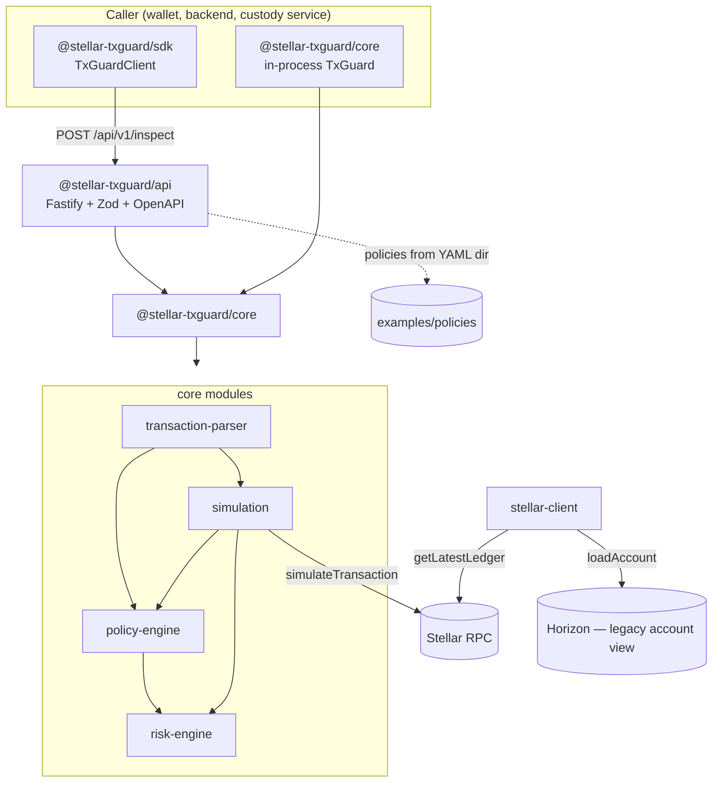

# stellar-txguard

**Transaction policy, simulation and risk firewall for Stellar applications.**

[](https://github.com/StellarOpenInfrastructure/stellar-txguard/actions/workflows/ci.yml)
[](https://github.com/StellarOpenInfrastructure/stellar-txguard/actions/workflows/security.yml)
[](LICENSE)
[](#roadmap)
[](docs/drips-wave.md)

> Inspect a Stellar transaction _before_ it is signed: parse it, simulate it,
> evaluate it against a declarative policy and score its risk. TxGuard never
> holds keys and never submits transactions.

---

## Problem

Wallets, custodians, payout services and DAOs sign Stellar transactions built by
other systems — a backend, a dApp, a partner API. Once signed, a transaction is
final. Today most teams either trust the builder completely or hand-roll
ad-hoc checks ("is the amount below X?") scattered through their code.

There is no shared, testable, declarative layer that answers:

- _Is this transaction allowed by our policy?_
- _Will it succeed if submitted, and what will it cost?_
- _How risky does it look compared to what we usually do?_

## Solution

`stellar-txguard` is a small, composable inspection pipeline:

```
XDR ──▶ parse ──▶ simulate (Soroban) ──▶ policy ──▶ risk ──▶ recommendation
```

- **Transaction parser** — normalizes classic and Soroban envelopes (including
  fee bumps and SEP-41 token transfers) into one structure.
- **Policy engine** — YAML/JSON policies with rules like `max_amount`,
  `allowed_destinations`, `contract_allowlist` and `daily_limit`; every
  violation carries a stable code.
- **Simulation** — runs `simulateTransaction` against Stellar RPC and exposes
  resource usage, fees and auth requirements.
- **Risk engine** — pluggable heuristics produce a 0–100 score and level.
- **API + SDK** — a Fastify service with OpenAPI docs and a dependency-free
  TypeScript client, or use the core library in-process.

The result is a single `InspectionReport` with a recommendation:
`sign`, `review` or `reject`.

## Why Stellar

- Stellar transactions are deterministic XDR — they can be fully inspected
  offline before signing.
- Stellar RPC's `simulateTransaction` gives exact resource and fee estimates for
  Soroban invocations, which lets policies reason about _what a contract call
  will do_ rather than only _who it calls_.
- Soroban's authorization model surfaces the auth entries a transaction needs,
  making "unexpected authorization" detectable up front.
- Stellar's payment-focused ecosystem (anchors, wallets, payout rails) needs
  compliance-friendly, auditable controls without custodial middlemen.

## Architecture



### Stellar infrastructure consumed

| Component            | Uses                                                     | Why                                                                                                       |
| -------------------- | -------------------------------------------------------- | --------------------------------------------------------------------------------------------------------- |
| `transaction-parser` | `@stellar/stellar-sdk` XDR                               | decode envelopes offline                                                                                  |
| `simulation`         | **Stellar RPC** `simulateTransaction`                    | Soroban resource/fee/auth estimation                                                                      |
| `stellar-client`     | Stellar RPC `getLatestLedger`; **Horizon** `loadAccount` | readiness probe; account balances/thresholds (Horizon kept only until an RPC-based account view is added) |
| `policy-engine`      | none (pure)                                              | deterministic, testable                                                                                   |
| `risk-engine`        | none (pure)                                              | deterministic, testable                                                                                   |

No indexer is required. Known-destination / known-contract sets are supplied by
the caller (from its own history), not by an indexing service.

## Features

- ✅ Parse classic and Soroban envelopes, fee bumps, memos, time bounds
- ✅ Extract value transfers from payments, path payments, `createAccount`
  and SEP-41 `transfer` invocations
- ✅ Declarative policies (`version: 1`) validated with Zod, loaded from YAML
- ✅ Rules: `max_amount`, `allowed_assets`, `blocked_assets`,
  `allowed_destinations`, `required_memo`, `simulation_required`,
  `contract_allowlist`, `daily_limit`
- ✅ `deny` or `review` on violation
- ✅ Simulation via Stellar RPC (or a static simulator for tests)
- ✅ Risk scoring with nine built-in heuristics and a plug-in interface
- ✅ Fastify API with `/api/v1`, request ids, consistent errors, OpenAPI at
  `/docs`, `GET /health`, `GET /ready`
- ✅ TypeScript SDK
- ✅ Docker image and compose file
- ⏳ Persistent spending ledger (PostgreSQL/Redis) — [roadmap](#roadmap)
- ⏳ Policy persistence and versioning — roadmap
- ⏳ Web dashboard — roadmap

## Repository structure

```
stellar-txguard/
├── packages/
│   ├── core/                 # @stellar-txguard/core
│   │   └── src/
│   │       ├── transaction-parser/
│   │       ├── policy-engine/
│   │       ├── simulation/
│   │       ├── risk-engine/
│   │       ├── stellar-client/
│   │       └── inspector.ts  # TxGuard orchestrator
│   └── sdk/                  # @stellar-txguard/sdk (HTTP client)
├── backend/                  # @stellar-txguard/api (Fastify)
│   └── src/routes/           # health, policies, inspect
├── examples/policies/        # YAML policy examples
├── scripts/                  # openapi export, in-process example
├── docs/
│   ├── architecture/ api/ guides/ security/ adr/
│   └── drips-wave.md         # contributor issue backlog
├── .github/workflows/        # ci.yml, security.yml
├── docker-compose.yml, backend/Dockerfile
└── Makefile
```

There is no `frontend/` yet: the first users are backends and wallets calling
an API. A policy-authoring dashboard is on the roadmap. There is no
`contracts/`: TxGuard inspects transactions off-chain and needs no on-chain
component.

## Requirements

- Node.js ≥ 22
- pnpm ≥ 10 (`corepack enable`)
- Docker (optional, for the container image)

## Installation

```bash
git clone https://github.com/StellarOpenInfrastructure/stellar-txguard
cd stellar-txguard
make setup
```

## Configuration

Copy `.env.example` to `.env`. All settings are environment variables; see the
file for descriptions. Key values:

| Variable               | Default               | Purpose                              |
| ---------------------- | --------------------- | ------------------------------------ |
| `STELLAR_NETWORK`      | `testnet`             | `testnet`, `mainnet` or `custom`     |
| `STELLAR_RPC_URL`      | testnet RPC           | required for `mainnet`/`custom`      |
| `POLICY_DIR`           | `./examples/policies` | YAML policies loaded at startup      |
| `SIMULATION_ENABLED`   | `false`               | simulate Soroban txs via RPC         |
| `REVIEW_AT_RISK_LEVEL` | `high`                | send allowed-but-risky txs to review |

## Development

```bash
make dev          # API with hot reload on http://localhost:4010 (docs at /docs)
make test         # vitest
make lint         # eslint + prettier
make typecheck
make build
make example      # run an inspection in-process
make openapi      # regenerate docs/api/openapi.json
```

## Testing

- Unit tests live beside the code (`*.test.ts`): parser, every policy rule,
  risk heuristics, the orchestrator and the SDK client.
- API integration tests use Fastify's `inject` (no network).
- Nothing in the test suite touches the Stellar network; simulation is covered
  by the `StaticSimulator`. Live-RPC tests are a roadmap item.

```
pnpm run test
```

## API

Base path `/api/v1`. Full OpenAPI document: [`docs/api/openapi.json`](docs/api/openapi.json),
interactive at `/docs` when the server runs.

| Method | Path                   | Description                            |
| ------ | ---------------------- | -------------------------------------- |
| `GET`  | `/health`              | liveness                               |
| `GET`  | `/ready`               | readiness (checks RPC when configured) |
| `GET`  | `/api/v1/policies`     | list policies                          |
| `GET`  | `/api/v1/policies/:id` | get a policy                           |
| `POST` | `/api/v1/policies`     | create a policy (in-memory)            |
| `POST` | `/api/v1/inspect`      | inspect a transaction envelope         |
| `GET`  | `/api/v1/openapi.json` | OpenAPI document                       |

```bash
curl -s localhost:4010/api/v1/inspect -H 'content-type: application/json' -d '{
  "envelopeXdr": "AAAAAgAAAAD...",
  "policyId": "default"
}' | jq .recommendation
```

Errors always have the shape
`{ "error": { "code", "message", "requestId", "details?" } }` and every
response carries an `x-request-id` header.

## SDK

```ts
import { TxGuardClient } from "@stellar-txguard/sdk";

const guard = new TxGuardClient({ baseUrl: "http://localhost:4010" });
const report = await guard.inspect({ envelopeXdr, policyId: "default" });
if (report.recommendation !== "sign") {
  throw new Error(`blocked: ${report.policy.violations.map((v) => v.code).join(", ")}`);
}
```

Or in-process, without a server:

```ts
import { TxGuard, loadPolicyFromYaml, RpcSimulator } from "@stellar-txguard/core";

const guard = new TxGuard({
  simulator: new RpcSimulator({ rpcUrl: "https://soroban-testnet.stellar.org" }),
});
const report = await guard.inspect({
  envelopeXdr,
  networkPassphrase,
  policy: loadPolicyFromYaml(yaml),
});
```

## Contracts

Not applicable — TxGuard is an off-chain inspection layer.

## Deployment

```bash
make docker-build
docker run --rm -p 4010:4010 -e STELLAR_NETWORK=testnet stellar-txguard-api:local
# or
make docker-up
```

The image runs as a non-root user and exposes a Docker `HEALTHCHECK` on
`/health`. Put a TLS-terminating proxy in front of it and restrict
`CORS_ORIGINS` before exposing it publicly.

## Security

See [SECURITY.md](SECURITY.md) for reporting and
[docs/security/overview.md](docs/security/overview.md) for the security model.
Highlights:

- TxGuard never receives private keys and never submits transactions.
- Request bodies are size-limited and schema-validated; XDR is decoded with
  the official SDK.
- Logs redact `authorization`, `cookie`, `apiKey`, `secret*`, `privateKey`,
  `token` fields.
- The API has **no authentication in this scaffold** — run it on a private
  network. API-key auth is a Drips Wave issue.

## Threat model

Summarized from [docs/security/overview.md](docs/security/overview.md):

| Threat                                           | Mitigation                                             | Status                 |
| ------------------------------------------------ | ------------------------------------------------------ | ---------------------- |
| Malicious transaction from a compromised builder | policy rules + risk heuristics + simulation            | ✅ scaffold            |
| Policy bypass via malformed XDR                  | strict decoding; parse errors → `reject` path          | ✅                     |
| Policy tampering                                 | policies are files/API objects; API is unauthenticated | ⚠️ needs auth          |
| Daily-limit race across instances                | in-memory ledger is per-process                        | ⚠️ needs shared ledger |
| RPC returns wrong simulation                     | RPC is trusted; use your own node                      | documented             |
| Log leakage of secrets                           | pino redaction                                         | ✅                     |

## Roadmap

1. Persistent `SpendingLedger` (PostgreSQL) and policy store
2. API-key / mTLS authentication and per-key policies
3. RPC-based account view to drop Horizon
4. Soroban auth-entry inspection rules (`allowed_auth_invokers`)
5. Live-RPC integration test suite against testnet
6. Policy dashboard (Next.js)
7. Rust core for embedding in signers

The concrete backlog is in [docs/drips-wave.md](docs/drips-wave.md).

## Contributing

See [CONTRIBUTING.md](CONTRIBUTING.md). Pick an issue from
[docs/drips-wave.md](docs/drips-wave.md), comment to claim it, open a PR.

## Drips Wave contribution areas

| Area            | Examples                                                 |
| --------------- | -------------------------------------------------------- |
| Policy rules    | new rule types, better messages, rule docs               |
| Parser coverage | more operation types, muxed accounts, claimable balances |
| Risk heuristics | velocity, trustline changes, signer changes              |
| API             | auth, pagination, persistence, rate limits               |
| SDK             | retries, browser build, Rust client                      |
| Docs & examples | guides, policy cookbook, diagrams                        |
| DevOps          | live-RPC tests, release automation                       |

## License

Apache-2.0 — see [LICENSE](LICENSE).

## Disclaimer

This is an **initial scaffold**, not a security product. Policies and risk
heuristics are only as good as their configuration and tests. Do not rely on
TxGuard as the sole control for mainnet funds. No warranty is provided; see the
license.
