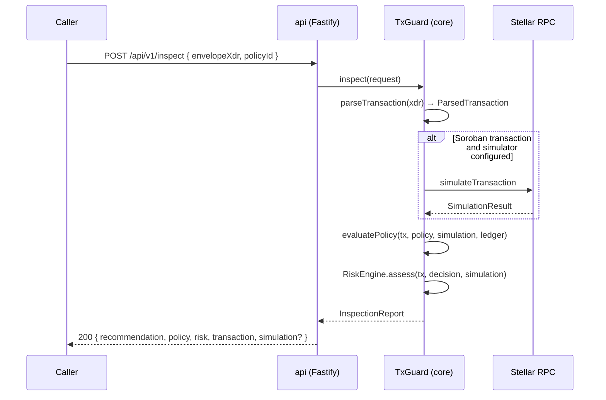

# Architecture overview

## Pipeline

## Modules

| Module               | Responsibility                                                 | Depends on                       |
| -------------------- | -------------------------------------------------------------- | -------------------------------- |
| `transaction-parser` | XDR → `ParsedTransaction`                                      | `@stellar/stellar-sdk`           |
| `policy-engine`      | Policy schema, YAML loading, rule evaluation, `SpendingLedger` | parser types                     |
| `simulation`         | `Simulator` interface, `RpcSimulator`, `StaticSimulator`       | stellar-sdk `rpc`                |
| `risk-engine`        | `RiskHeuristic` interface, defaults, scoring                   | parser, policy, simulation types |
| `stellar-client`     | read-only ledger access (RPC + Horizon)                        | stellar-sdk                      |
| `inspector`          | `TxGuard` orchestrator                                         | all of the above                 |

The parser is the only module that touches XDR. Every downstream module works
with plain data, which keeps rules and heuristics trivially testable.

## Design decisions

- **Policies are data, not code.** A policy is a validated JSON/YAML document.
  This makes policies reviewable, diffable and storable.
- **Conservative amounts.** Path payments count `sendMax`, not the expected
  amount, because the sender can lose up to `sendMax`.
- **Soroban token transfers are first-class.** A `transfer(from, to, amount)`
  invocation is exposed as a transfer with a `contract` asset so `max_amount`
  and `allowed_destinations` cover tokens too.
- **Simulation is optional but policy-enforceable.** `simulation_required`
  fails closed when no simulation is available.
- **Risk is additive and capped.** Heuristic weights sum to a score capped at
  100; levels are thresholds (20/50/75). The engine is deliberately simple so
  operators can reason about it; ML scoring is out of scope.
- **No custody.** The service never sees secret keys and cannot submit.

## Data flow of the `daily_limit` rule

`daily_limit` needs state. The `SpendingLedger` interface is injected into the
engine. The scaffold ships `InMemorySpendingLedger`; a PostgreSQL implementation
is a tracked issue. Callers are responsible for calling `ledger.record()` after
a transaction is actually submitted — TxGuard itself only _reads_ the ledger.

## Extension points

- `RiskHeuristic` — implement `evaluate(ctx): RiskSignal[]` and pass a custom
  list to `new RiskEngine([...])`.
- `Simulator` — swap RPC for a cached or mocked provider.
- `SpendingLedger` — plug in a shared store.
- Policy rules — add a rule to `policyRulesSchema` and `RULES` in
  `policy-engine/rules.ts` with tests.
